<!-- Generated by scripts/generate.py. Edit profile.json, then regenerate. -->

  
   
  <a href="https://github.com/CoreRCE"><code>GitHub</code></a> &nbsp;·&nbsp; <a href="https://corerce.com"><code>Blog</code></a> &nbsp;·&nbsp; <a href="mailto:byovd@pm.me"><code>Email</code></a>

  

> 我们从深渊观察 

<table>
<tr>
<td width="50%" valign="top"><h3><a href="https://github.com/CoreRCE/private-navigation-system">private-navigation-system</a></h3>
支持自托管的私人导航页，提供 JWT 认证、链接分类、搜索和 JSON 文件存储。

<code>TypeScript</code>
</td>
<td width="50%" valign="top"><h3><a href="https://github.com/CoreRCE/react-shadcn-admin">react-shadcn-admin</a></h3>
基于 React、Go 和 SQLite 的全栈后台框架，支持用户管理、主题切换和中英双语。

<code>TypeScript / Go</code>
</td>
</tr>
<tr>
<td width="50%" valign="top"><h3><a href="https://github.com/CoreRCE/Vben-Admin-Antd-Lite">Vben-Admin-Antd-Lite</a></h3>
基于 Vue Vben Admin 的精简后台模板，保留 Ant Design Vue 应用和本地 Mock API。

<code>Vue / TypeScript</code>
</td>
<td width="50%"></td>
</tr>
</table>

<picture>
  <source media="(prefers-color-scheme: dark)" srcset="./snake-dark.svg"/>
  <source media="(prefers-color-scheme: light)" srcset="./snake.svg"/>
  
</picture>

设计来源

终端视觉与章节结构参考 <a href="https://github.com/moiz-codez/moiz-codez">moiz-codez/moiz-codez</a>，SVG 和生成脚本独立实现。字体为 <a href="https://github.com/JetBrains/JetBrainsMono">JetBrains Mono</a>，按 SIL OFL 1.1 使用。

